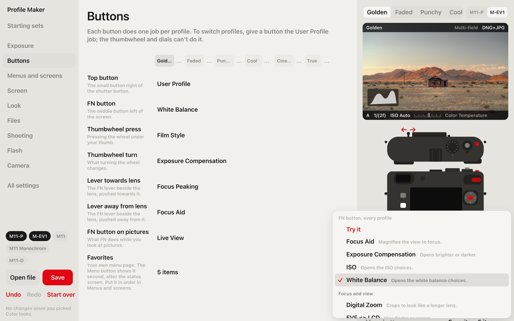
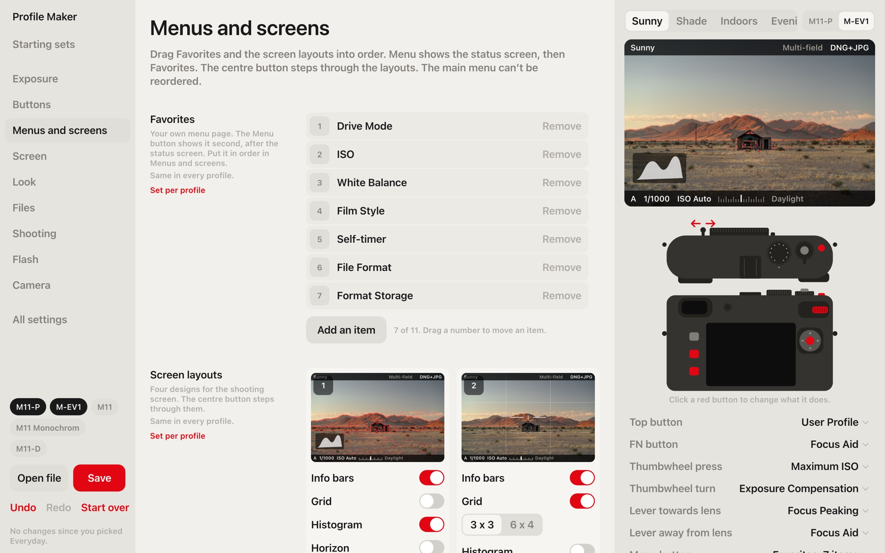

# Profile Maker

Set up your Leica M11, M11-P, M11-D, M11 Monochrom or M-EV1 on a big screen, then give it to the camera as one file.

**[Open Profile Maker](https://timoarnall.github.io/leica-setup/app/)** · [About](https://timoarnall.github.io/leica-setup/) · [Documentation](docs/README.md)

<picture>
  <source media="(prefers-color-scheme: dark)" srcset="site/images/hero-dark.jpg">
  
</picture>

## Why

A Leica keeps its settings in profiles: up to six named sets you switch between while you shoot. Setting them up on the camera is slow work.

- **A new camera is an evening of menus.** Hundreds of settings, four buttons and an arrow pad to reach them, one value at a time.
- **Names are typed letter by letter.** Renaming a profile or filling the Favorites page means stepping through tiny menus, and Favorites can't be dragged into order.
- **One change, six times.** A setting you want in every profile has to be changed in every profile, menu by menu.
- **Two bodies drift apart.** An M11-P and an M-EV1 have slightly different menus and values. Keeping them in step by hand is guesswork.
- **You can't compare.** The camera shows one profile at a time, so you can't see what makes Fast different from Slow.
- **No undo.** A stray press changes a profile and nothing tells you.
- **The settings file is unreadable.** The camera can export everything to its card, but as four-letter codes and numbers. When a value in it isn't allowed, the camera skips it without a word.
- **Starting again from memory.** After a reset, a repair or a firmware update, your setup lives only in your head.

## What it does

- **Starting sets.** Fifteen groups of profiles to begin from, each with buttons, Favorites, screen layouts and a look already set. Or start from the factory settings, or open your camera's own export.
- **Every profile side by side.** A setting that is the same everywhere shows once; change it once for all of them.
- **The camera, drawn.** The buttons you can set are red. Click one to choose its job from a short, grouped list, or try it on the pretend screen, which shows a profile over a real photo with its white balance, film style and screen layout.
- **Menus and screens.** Drag Favorites and the four screen layouts into the order you want.
- **One file per camera.** Pick your bodies; each gets its own file, with any value it doesn't have swapped for the closest one, and a list of every swap.
- **Plain words.** Every setting has a plain name and one line saying what it does. Every page says what a file can and can't change.
- **Undo everything.** Undo, Redo and Start over are always there. Changed values are marked, and Save lists every change.
- **Nothing leaves your computer.** It runs in the browser, on a phone too. A Mac app writes the file straight onto a camera card.

<picture>
  <source media="(prefers-color-scheme: dark)" srcset="site/images/buttons-dark.jpg">
  
</picture>

## How to use it

1. Open Profile Maker and pick your cameras.
2. Pick a starting set, or open the file your camera exported (User Profile, Manage Profiles, Export Profiles).
3. Change anything. Point at a setting to see what it does.
4. Save. Copy `settings.lcse` to the top level of the card, then on the camera choose User Profile, Manage Profiles, Import Profiles.

Importing replaces every profile on the camera. Export your own first, so you can go back.

## Starting sets

| Set | Profiles |
|---|---|
| Speed ladder | Fast, Medium, Slow, Sloow: four shutter speed limits for less and less light |
| Everyday | Sunny, Shade, Indoors, Evening, Night, Tripod |
| Motion | Freeze, Crisp, Walk, Pan, Drag, Streak: shutter speed as the creative choice |
| Color looks | Golden, Faded, Punchy, Cool, Cinema, True |
| Cinema | Day, Golden, Dusk, Neon, Interior, Noir |
| Black and white | Soft, Mono, Hard, Noir, Grain, Color |
| Street | Sunny, Shade, Inside, Night, Mono |
| Portrait | Outdoor, Window, Flash, Mono |
| Landscape | Tripod, Walk, Bracket, Blue hour, Mono |
| Night | Dark, Darker, Lights, Stars |
| Events | Quiet, People, Party, Details, Speeches |
| Film habits | Film, Film Mono, Pushed |
| Travel | Day, Museum, Food, Night, Saver |
| Kids and pets | Run, Play, Inside, Asleep |
| Factory | One profile with every setting as a new camera has it |

A profile can’t set shutter speed, aperture or ISO. With the dials on A it sets limits instead, which are often more useful than fixed values. Set the aperture yourself, or use an ND filter.

<picture>
  <source media="(prefers-color-scheme: dark)" srcset="site/images/menus-dark.jpg">
  
</picture>

## Technical details

### What the settings file exposes

- **One JSON file**, `settings.lcse`, at the top level of the card. `Camera` names the body, `Version` a number the camera writes, `Settings` the values.
- **Four-character codes.** Each setting has a code such as `D00C` (slowest shutter speed). The M11, M11-P and M-EV1 write 139 codes, the M11-D 140 and the M11 Monochrom 145.
- **Seven slots.** A per-profile setting holds seven values: the live settings, then profiles one to six. A camera-wide setting holds one.
- **Profiles.** Six names of 3 to 10 letters, numbers, spaces or dashes; a mask of which profiles are saved; the profile the camera starts in.
- **Buttons.** The jobs of the top button, FN, thumbwheel press and turn, FN on pictures, and the M-EV1's two-way FN lever, per profile.
- **Favorites and screen layouts.** Favorites is an ordered list of up to 11 menu items per profile. Each of the four screen layouts sets info bars, grid, histogram, horizon, clipping and focus peaking.
- **Everything else** the camera menus hold, from white balance and film styles to file names, copyright and power saving. Every code, its values and its factory value: [docs/settings](docs/settings/README.md).

### Interesting bits

- **The camera checks one thing before importing:** that `Camera` matches the body exactly. A file from an M11-P is ignored by an M-EV1 until its name is changed.
- **Every value is checked on its own.** A value the camera doesn't allow is skipped, and a code missing from the file keeps the camera's current value. Neither gives a message, so Profile Maker lists them when you open a file.
- **Profiles not marked as saved are reset** when a file is imported. Profile Maker always writes the mask to match the profiles you made.
- **No export is needed.** Every setting's factory value is known, so a file can be built from scratch for any of the five bodies.
- **The same code can mean different things.** `D010` is the ISO on the M-EV1 but the ISO dial's M position on the M11-P.
- **Profiles can only be switched from a button.** The User Profile job goes on a button; no dial or thumbwheel turn can take it.
- **Shutter speed, aperture and ISO are not in the file.** They are on the dials and the lens; with the dials on A, a profile sets limits instead. The M-EV1 has no ISO dial, so its ISO is in the file.

What is not yet known, as questions anyone with a camera can settle: [docs/open-questions.md](docs/open-questions.md).

### Files

| Path | What it is |
|---|---|
| `index.html`, `src/app.js`, `src/app.css` | The page |
| `src/engine.js` | Reads, checks, converts and writes settings files; used by the page and the tests |
| `src/rules.js` | Every code for every camera: kind, allowed values, factory value, the camera's own names. Generated; don't edit by hand |
| `src/catalogue.js` | Plain names, help, themes, notes and the grouping of job lists |
| `src/sets.js` | The starting sets |
| `src/camera.js`, `src/photos.js` | The camera drawing, the pretend screen and its photo |
| `site/` | The project page on GitHub Pages; the app is published beside it at `app/` |
| `mac/` | The Mac app around the same page, with card writing and backups |
| `docs/` | The documentation; `docs/settings/` is generated by `tools/build_docs.py` |

### Extending it

- **A starting set:** add it to `src/sets.js`. The tests check that every value is allowed on the M11-P and M-EV1 and converts cleanly to the other bodies.
- **Plain names and help:** `src/catalogue.js`, then `python3 tools/build_docs.py` to refresh the docs.
- **A camera or firmware version:** see [docs/README.md](docs/README.md). A real export with Artist, Copyright and network name blanked is the place to start.
- **Tests:** `node --test test/*.test.js` runs on every push. `test/browser-check.js` clicks through the page in Safari's engine and Chrome at desktop and phone sizes.
- **Mac app:** `zsh mac/build.sh`, then open `build/Profile Maker.app`.

Not yet tried: importing a file made from scratch on a camera. Check a few settings after your first import.

## Licence

MIT. See [LICENSE](LICENSE). The photo on the camera screen is by Timo Arnall.

Profile Maker is not made by or connected to Leica Camera AG. Leica, M11 and M-EV1 are trademarks of Leica Camera AG. The app contains no Leica firmware, manuals or artwork; the camera drawing and the screen are drawn here.
