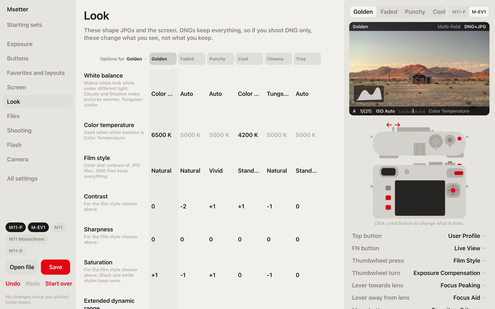

# Msetter

Msetter is a free app for setting up a Leica M from a computer or phone instead of the camera's menus. You design the camera's user profiles side by side, choose what each button does, put the Favorites menu and the screen layouts in order, and save one settings file for each of your cameras. The camera loads it from its memory card in one step. It runs in your browser and nothing is uploaded. Works on the M11, M11-P, M11-D, M11 Monochrom and M-EV1.

**[Try the app](https://timoarnall.github.io/msetter/app/)**

<picture>
  <source media="(prefers-color-scheme: dark)" srcset="site/images/hero-dark.jpg">
  
</picture>

### Why

**Typing on a camera is painful.** Profile names, copyright and file names are spelled out one letter at a time with the arrow pad.

**Menus are deep and small.** Every setting sits a few levels down a menu built for a three-inch screen, reached with a few buttons and a wheel. A new camera takes hours to set up.

**Each profile needs the same change.** A setting you want everywhere has to be changed in every user profile, one at a time.

**The Leica FOTOS app doesn't fix it.** It can change some settings from your phone, but it is still slow, one setting at a time, with little way to organise your user profiles, menus or buttons.

**Two cameras drift apart.** An M11-P and an M-EV1 have slightly different menus and options. Keeping them alike means going through every menu on both.

**Profiles can't be compared.** The camera shows one user profile at a time, so you can't see what makes Fast different from Slow.

**There is no undo.** A stray press changes a profile and nothing tells you.

**The settings file can't be read.** The camera saves its settings to the card as four-letter codes and numbers. When a value in a file isn't allowed, it skips it without a word.

**A reset starts you from scratch.** After a reset, a repair or a firmware update your setup is gone unless you remember it.

### What it does

<picture>
  <source media="(prefers-color-scheme: dark)" srcset="site/images/in-action-dark.gif">
  
</picture>

**Your user profiles sit side by side**, one column each, with a row for every setting. A setting that is the same in every profile shows once, so one change reaches them all.

**The camera is drawn with its buttons and the ones you can set are red.** Click one to choose its job from a short list grouped by what it does, or to see what it does on the camera's screen.

**The camera's screen shows how each profile looks**, using a photo with the profile's white balance, film style, exposure and screen layout, so you can compare Golden with Cinema before you shoot.

**You drag the Favorites menu and the four screen layouts into order**, the order they appear in on the camera.

**Each of your cameras gets its own file.** A value one body doesn't have is swapped for the nearest one it does, and the app lists every swap.

**Every setting has a plain name and one line on what it does**, and each page says what a settings file can't change.

**Everything can be undone.** Changed values are marked, and Save lists every change before it writes the file.

**Nothing leaves your computer.** It runs in the browser on a computer or a phone, and a Mac app writes the file straight to the camera's card.

### Starting sets

Each set is a group of user profiles, Leica's name for the saved settings you switch between on the camera, made for one kind of photography. Every set also chooses what the buttons do, what is in the Favorites menu and how the screen layouts look.

**Profile switching goes on a button**, usually the top one, so one press takes you to the next profile. Every set here does that, and leaves FN on its factory job: Live View on the M11 bodies, the switch between viewfinder and screen on the M-EV1.

**A profile can't turn the dials or the aperture ring.** With the shutter speed and ISO dials on A it sets limits instead, the shutter speed limit and the maximum ISO, which are often more useful than fixed values. Once ISO reaches the maximum, the shutter goes slower than the limit. With the ISO dial on M a profile sets the ISO itself, as it always does on the M-EV1, which has no ISO dial. Set the aperture yourself, or use an ND filter.

- **Speed ladder.** User profiles for less and less light: Fast (1/1000, ISO 6400), Medium (1/250), Slow (1/(4f), ISO 3200) and Sloow (ISO 64, for a tripod). The top button steps through them.
- **Day and night.** Just two user profiles: Day (1/500, ISO 6400) and Night (1/60, ISO 25000).
- **Everyday.** User profiles from sun to night, each with its own limits and white balance: Sunny (1/1000, Daylight), Shade (1/250, Shadow), Indoors (1/125, ISO 12500), Evening, Night (1/f, ISO 25000) and Tripod (1/2, ISO 100, two second timer).
- **Motion.** Shutter speed as the look: Freeze at 1/2000, Crisp at 1/500, Walk at 1/60, Pan at 1/30 with bursts, then Drag and Streak at 1/15 and 1/2 with low ISO limits, so the camera picks slow speeds and movement blurs.
- **Color looks.** JPG looks: Golden (Natural, warmed to 6500 K), Faded (low contrast, extended dynamic range), Punchy (Vivid), Cool (4200 K), Cinema (Tungsten, flat and dark) and True. A DNG is kept beside every JPG.
- **Cinema.** Graded user profiles with a speed limit for each light: Day (flat, 5500 K, 1/125), Golden (7200 K), Dusk (Tungsten, darker), Neon (Vivid, ISO 25000), Interior (4200 K) and Noir (high contrast black and white). Metering protects the highlights.
- **Black and white.** Soft, Mono, Hard and Noir step up the contrast. Grain lets ISO climb to 50000 with noise reduction low. Color keeps one profile in color. Color DNGs are kept beside the JPGs, and focus peaking is white.
- **Street.** Fast limits for Sunny (1/500), Shade (1/250), Inside (1/125, ISO 25000) and Night (1/60), plus Mono. Metering keeps the highlights. No picture review, and touch is off while shooting.
- **One speed.** For leaving the shutter dial on one speed all day, often 1/250. Each profile fixes the ISO and white balance for its light: Sun (ISO 200, Daylight), Shade (400, Shadow), Inside (3200), Night (6400), and Pushed at 3200 in high contrast black and white. No picture review and no touch, as with film. On a camera with an ISO dial, set it to M.
- **Portrait.** Softer color, with lower contrast and saturation: Outdoor, Window, Flash and Mono. Pressing the thumbwheel magnifies for exact focus.
- **Landscape.** Tripod at ISO 64 with a two second timer, a handheld Walk, a five frame Bracket, Blue hour at 1/8 in daylight balance, and Mono. Grid, horizon and histogram on screen.
- **Night.** Dark (1/f, ISO 25000), Darker (1/30, ISO 50000), Lights (Tungsten for street lights) and Stars (ISO 3200 on a tripod, 3900 K). The camera's lights are off and the screens dimmed.
- **Events.** Quiet (silent shutter, lights off), People (Natural color), Party (flash with motion trails), Details (1.3x digital zoom) and Speeches (silent, ISO 25000, bursts). Pressing the thumbwheel magnifies for exact focus.
- **Travel.** Day, Museum (silent, ISO 25000, lights off), Food (Vivid), Night, and Saver, which turns the phone connection off and sleeps sooner. Date and time are in Favorites for changing time zones.
- **Kids and pets.** Run (1/1000, fast bursts), Play (1/500), Inside (1/250, ISO 25000) and Asleep (1/60, silent).
- **Factory.** One user profile with every setting as a new camera has it.

### How to use it

**Pick your cameras.** Open the app and choose the Leica cameras you own. Msetter makes a separate file for each, so two bodies can share one design even where their menus differ.

**Start from a set or from your own camera.** Pick a starting set, or the factory settings. To begin from what is already on your camera, save its settings to the card first: in the camera's menu choose User Profile, then Manage Profiles, then Export Profiles. Open that file in the app or drop it on the page. The app lists any value in it that the camera would skip.

**Change what you like.** Settings are grouped by what they are for: exposure, buttons, Favorites and layouts, look, files, shooting, flash and the camera itself. Point at any setting to see what it does. Changed values are marked, and Undo takes back anything.

**Save and import.** Save makes a file called `settings.lcse` for each camera. Copy it to the top level of that camera's card, put the card back, and choose User Profile, Manage Profiles, Import Profiles. Importing replaces every user profile on the camera, so export your own first if you want to go back. The camera doesn't say when it skips a value, so check a few settings after your first import.

**On the camera**, press the top button to step through the profiles. If you change a setting, the camera shows Default instead of the profile's name. The change stays until you choose a profile again, which brings back what was saved.

**[Try the app](https://timoarnall.github.io/msetter/app/)**

### How it works

The camera keeps everything in **one JSON file, `settings.lcse`, at the top level of its card**. `Camera` names the body, `Version` is a number the camera writes, and `Settings` holds the values. Each setting has a four-character code, such as `D00C` for the shutter speed limit. A setting that belongs to a profile holds seven values: the one the camera is using now, then one for each of user profiles one to six. A setting for the whole camera holds one value. The M11, M11-P and M-EV1 write 139 codes, the M11-D 140 and the M11 Monochrom 145.

The file holds **the six profile names, which profiles are saved and which one the camera starts in**, the job of each button (top button, FN, thumbwheel press and turn, FN on pictures, and the M-EV1's FN lever both ways), the Favorites menu in order with up to 11 items per profile, the four screen layouts, and everything else in the camera's menus, from white balance and film styles to file names, copyright and power saving.

When you import, **the camera first checks that the `Camera` name in the file matches its own exactly**. If it doesn't, nothing is imported and nothing is shown. If it does, the camera reads each value on its own: **a value it doesn't allow is skipped and the old value kept**, and a code missing from the file keeps its current value. **Profiles not marked as saved are reset.** None of this shows a message, so Msetter lists the values a camera would skip when you open a file, and marks the profiles it saves.

**A file can't move the dials or the lens.** Shutter speed, aperture and the ISO dial stay where they are, so a profile sets limits for A instead. A file also can't set the date, the time or the camera's network name, or reorder the main menu, and **user profiles can only be switched from a button**, not a dial. On the M-EV1, which has no ISO dial, the ISO is in the file; on the M11-P the same code sets the ISO the dial uses at M.

Msetter knows **every setting's factory value**, so it can build a file from scratch for any of the five bodies, without a file from the camera. **Files from Msetter match the camera's own.** Given the same values, a file built from scratch is the same, byte for byte, as a real export, apart from the network name, which newer firmware leaves out. A test checks this on every change. The camera has also imported a file edited by hand.

The **documentation** lists every code with its allowed values and its factory value on each camera in [docs/settings](docs/settings/README.md). How the controls, menus, Favorites and screen layouts fit together, with page references to Leica's manuals, is in [docs/interaction-architecture.md](docs/interaction-architecture.md). The file format is in [docs/file-format.md](docs/file-format.md), the differences between bodies in [docs/cameras.md](docs/cameras.md), and the questions anyone with a camera can help settle in [docs/open-questions.md](docs/open-questions.md).

| Path | What it is |
|---|---|
| `index.html`, `src/app.js`, `src/app.css` | The app |
| `src/engine.js` | Reads, checks, converts and writes settings files; used by the app and the tests |
| `src/rules.js` | Every code for every camera: kind, allowed values, factory value, the camera's own names. Generated; don't edit by hand |
| `src/catalogue.js` | Plain names, help, notes and the grouping of job lists |
| `src/sets.js` | The starting sets |
| `src/camera.js`, `src/photos.js` | The camera drawing, the camera screen and its photo |
| `site/` | This project's page on GitHub Pages; the app is published beside it at `app/` |
| `mac/` | The Mac app around the same page, with card writing and backups |
| `docs/` | The documentation; `docs/settings/` is generated by `tools/build_docs.py` |

To **add a starting set**, edit `src/sets.js`; the tests check every value on the M11-P and M-EV1 and convert it to the other bodies. Plain names and help live in `src/catalogue.js`; run `python3 tools/build_docs.py` afterwards to refresh the docs. To add a camera or a firmware version, start from a real export with the artist, copyright and network name blanked, and see [docs/README.md](docs/README.md). `node --test test/*.test.js` runs the tests, which also run on every push; `test/browser-check.js` clicks through the app in Safari's engine and Chrome at desktop and phone sizes. Build the Mac app with `zsh mac/build.sh`.

Free, under the MIT licence; see [LICENSE](LICENSE). The photo on the camera screen is by Timo Arnall. Msetter is not made by or connected to Leica Camera AG; Leica, M11 and M-EV1 are its trademarks. The app contains no Leica firmware, manuals or artwork.
