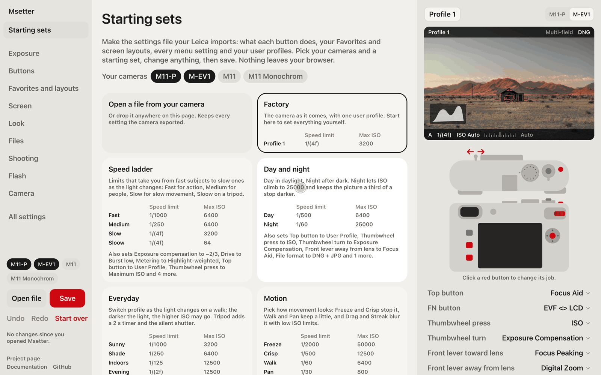
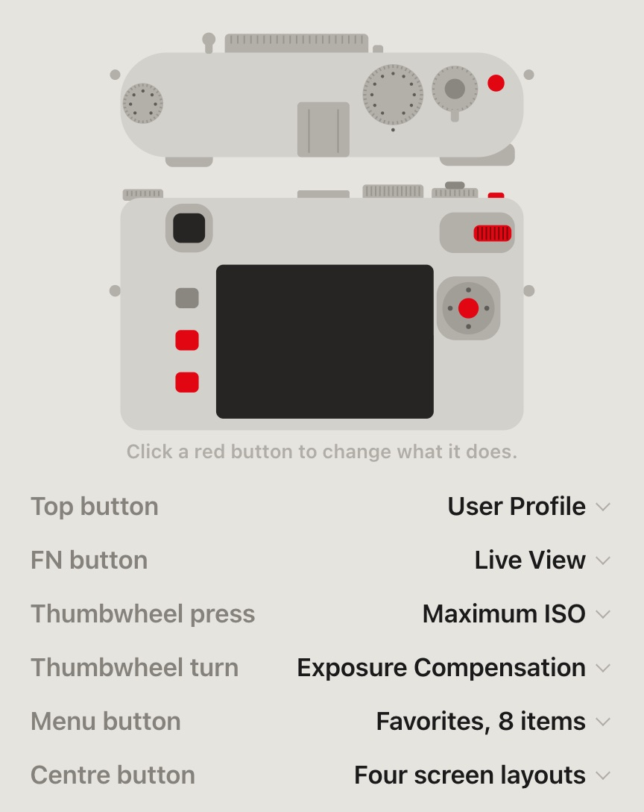
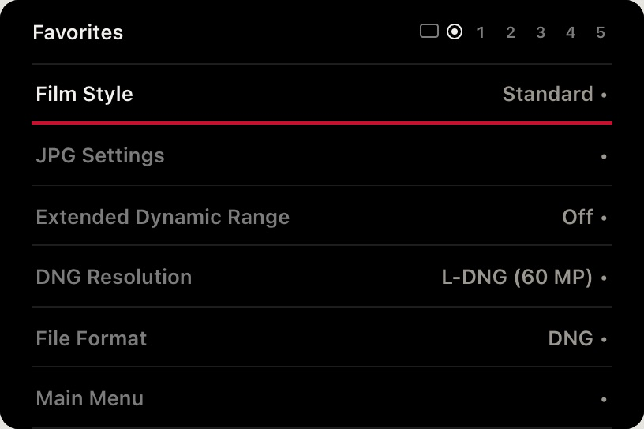
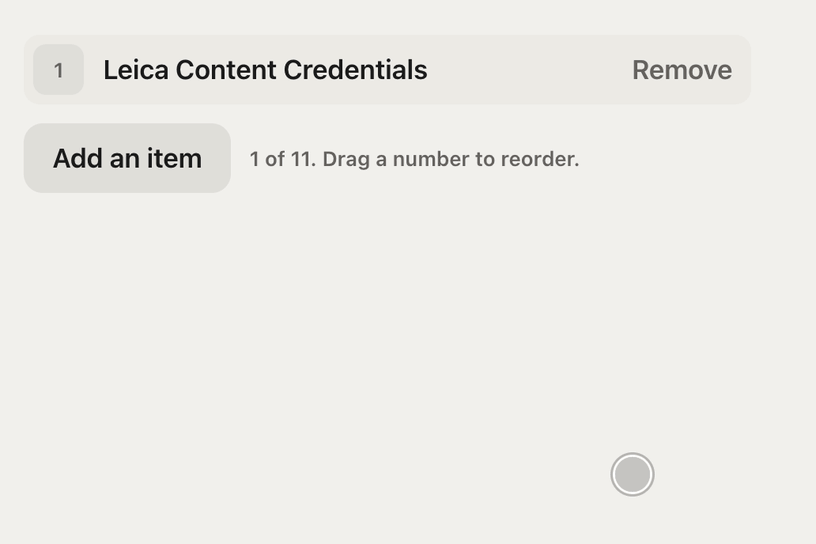
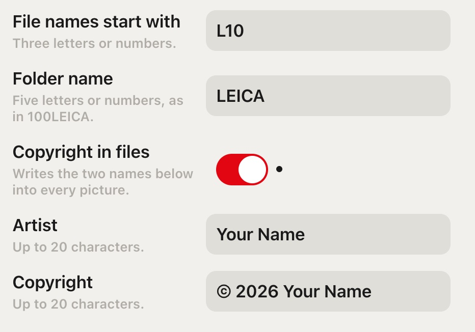
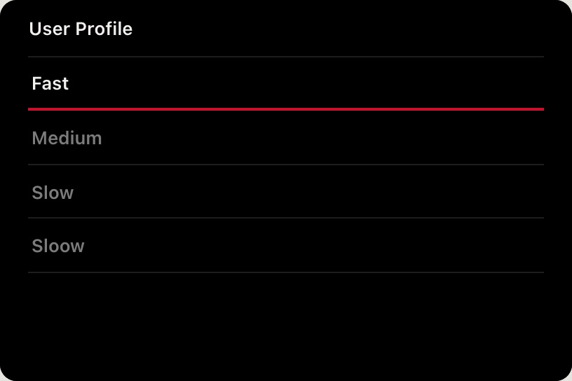

# Msetter

Msetter is a free app for setting up a Leica M. Choose what each button does, put your Favorites and screen layouts in order, type your copyright and file names on a real keyboard, and design your user profiles side by side. It saves a settings file for each of your cameras. **Everything stays in your browser.** Msetter makes no network requests, so nothing you open or make leaves your computer. Works on the M11, M11-P, M11 Monochrom and M-EV1.

**[Read the project page](https://timoarnall.github.io/msetter/)**, **[try the app](https://timoarnall.github.io/msetter/app/)**, or **[get the Mac app](https://github.com/timoarnall/msetter/releases/latest)**, which also saves straight to a camera card.

<a href="https://timoarnall.github.io/msetter/"><picture>
  <source media="(prefers-color-scheme: dark)" srcset="site/images/in-action-dark.gif">
  
</picture></a>

## Why

**Typing on a camera is painful.** Copyright, file names and profile names are spelled out one letter at a time with the direction pad.

**Menus are deep and small.** Every setting sits a few levels down a menu built for a three-inch screen. A new camera takes hours to set up.

**You keep starting from scratch.** After a reset, a repair or a firmware update, on a new body, and on a camera you borrow or rent, your setup is gone unless you remember it. Lend yours out and it may come back changed.

**The Leica FOTOS app doesn't fix it.** It changes some settings from your phone, one at a time, with little way to organize your buttons, Favorites or user profiles.

**Two cameras drift apart.** An M11-P and an M-EV1 have slightly different menus. Keeping them alike means going through every menu on both.

**Profiles multiply the work.** A change you want everywhere has to be made in every user profile, one at a time.

## Customize buttons

Choose what the top button, FN, the thumbwheel and the M-EV1's front lever do. In Msetter, choose each job from a list. The Menu and center buttons keep their jobs.

<picture>
  <source media="(prefers-color-scheme: dark)" srcset="site/images/feature-buttons-dark.jpg">
  
</picture>

**What do people tend to do?** [Where these come from](docs/pro-practice.md#buttons)

- Focus Aid on the top button, next to the shutter release, to magnify with the camera at the eye.
- Pressing the thumbwheel sets the ISO, with the ISO dial on M.
- Turning the thumbwheel sets exposure compensation for those who let the camera choose the shutter speed or ISO. Those who set exposure on the dials have it do nothing, so a bump can't change it.
- FN left on its default.
- The M-EV1 lever off, or on Focus Aid and peaking.

**Suggested button sets in the app**

- **Rangefinder.** Focus with the rangefinder and set exposure on the dials. The top button magnifies to check focus, pressing the thumbwheel sets the ISO, and turning it does nothing, so nothing changes by accident.
- **Exposure on the wheel.** Shoot on A with Auto ISO and steer it. Turn the thumbwheel for brighter or darker, press it for the maximum ISO, press FN for the slowest shutter speed. The top button opens Drive Mode for the self-timer and bracketing.
- **Profiles on FN.** Switch user profiles from FN and keep Focus Aid on the top button, where pros keep it. Pressing the thumbwheel opens exposure compensation; turning it does nothing.

## Organize the Favorites menu

Favorites holds up to eleven menu items you choose, and five fit on one page. In Msetter, add items from a list and drag them by their number into the order you want. On the camera, items stay in the order you added them; Msetter writes the order you drag. Each user profile can have its own Favorites.

<picture>
  <source media="(prefers-color-scheme: dark)" srcset="site/images/feature-favorites-screen-dark.jpg">
  
</picture>
<picture>
  <source media="(prefers-color-scheme: dark)" srcset="site/images/favorites-reorder-dark.gif">
  
</picture>

**What do people tend to do?** [Where these come from](docs/pro-practice.md#favorites)

- Short or empty. The status screen already has ISO, drive, white balance, file format and more.
- Choose things you need often that aren't on the status screen: film style, JPG settings, self-timer, shutter type, perspective control.
- The most-changed item first, and five or fewer, so it fits one page.

**Suggested Favorites sets in the app**

- **Empty.** Menu goes from the status screen straight to the main menu. For people who change everything from the status screen and the buttons.
- **JPG look.** Change the JPG look, the file type and the size without going into the main menu. For shooting DNG and JPG, often black and white to judge the light.
- **Tripod.** Set the self-timer, the silent shutter, straightening, noise reduction and brackets before a tripod shot.

## Choose your screen layouts

While you shoot, the center button steps from the full picture through each layout. Leica calls them info profiles. On the M11 bodies they show in Live View and the Visoflex, on the M-EV1 all the time. In Msetter, switch on what each of the four shows (info bars, grid, histogram, horizon, clipping, focus peaking) and drag them into order. An empty layout is skipped.

<picture>
  <source media="(prefers-color-scheme: dark)" srcset="site/images/feature-layouts-strip-dark.jpg">
  
</picture>

**What do people tend to do?** [Where these come from](docs/pro-practice.md#screen-layouts)

- Info bars only for everyday shooting.
- Peaking on Low and red, or off and one press away.
- Histogram and clipping in a separate layout, for checking hard light.
- Magnifying from a button, rather than automatically when the focus ring turns.
- On the M-EV1, exposure preview on all the time.

**Suggested screen layout sets in the app**

- **Clean.** The picture with only the exposure numbers; one press of the center button adds red peaking. For the rangefinder, opening Live View now and then.
- **Focus and check.** A clear view to compose, a focus view with peaking, and an exposure view with histogram and clipping when the light is hard. For the M-EV1 or the Visoflex.
- **Tripod.** Level the camera with the grid and horizon, check exposure with histogram and clipping and nothing over the edges, then focus with peaking.

## Change system settings

Change the deep settings without digging through the camera's menus: film styles, file names, copyright, power saving and everything else. Each has a plain name and one line on what it does, and you type your copyright and file names on a keyboard instead of one letter at a time.

<picture>
  <source media="(prefers-color-scheme: dark)" srcset="site/images/feature-settings-dark.jpg">
  
</picture>

**What do people tend to do?** [Where these come from](docs/pro-practice.md#menu-settings)

- Picture review off, so the finder is free for the next frame.
- Touch off while shooting, so a nose can't move the focus point. Off (LV mode) keeps touch for menus and pictures.
- Peaking sensitivity Low, for fewer marks that mean more.

**Sensible defaults.** Every new file starts with these. Change any of them in the app.

- Peaking sensitivity Low
- Picture review off
- Touch off while shooting
- ISO on Auto at M on the ISO dial, and on the M-EV1

## Set up custom profiles for different subjects

A user profile is a way of shooting. Each one remembers many settings at once: how slow the shutter may go, how high the ISO may climb, the color and the JPG look, what the buttons do. Switch profile and they all change together, so going from bright sun into a dark room is one press, not ten settings. In Msetter each profile is a column, so you see what changes from one to the next. The camera holds up to six.

<picture>
  <source media="(prefers-color-scheme: dark)" srcset="site/images/feature-profiles-screen-dark.jpg">
  
</picture>

**What do people tend to do?** [Where these come from](docs/pro-practice.md#user-profiles)

- One for each kind of work or subject, such as landscape and portrait.
- Few, often just one, holding file formats and a few shortcuts.
- One kept as a copy of the whole setup, to put it back after a firmware update.
- A black and white profile, so the screen and viewfinder show the picture in black and white.
- Each with its own Favorites and its own lens choice, handy for a lens without a code.
- Switched from the status screen.

**Suggested profile sets in the app**

- **For changing light.** Everyday, Day and night, Street, Cinema, One speed and Speed ladder. Switch profile as the light changes.
- **For a kind of picture.** Motion, Portrait, Landscape, Night, Events, Travel, and Kids and pets. One profile for each situation in it.
- **For a look.** Color looks and Black and white. A JPG look in each profile; every picture also saves a DNG.
- **To start clean.** Factory: the camera as it comes, with one profile and sensible defaults.

**Useful profiles**

- **Day.** Sharp handheld, fast phone link.
- **Museum.** Silent shutter, no review, status light off.
- **Food.** Vivid color, +1/3 EV, 3 s review.
- **Night.** ISO up to 25000, −1/3 EV.
- **Saver.** Phone off, dim screens, off after 1 min.

## How to use it

1. **Pick your cameras.** Choose the cameras you own; they can share one set of settings. If a camera lacks a setting, Msetter uses the closest one it has and tells you.
2. **Begin with your own settings or a suggestion.** To use your own, export them from the camera to the card (User Profile › Manage Profiles › Export Profiles) and open that file in Msetter. Or pick one of the suggested sets.
3. **Change what you like.** Every setting is on one page with a plain name and a line on what it does, so nothing is buried in menus. Your profiles sit side by side, so one change can go to all of them at once. The drawing shows what the camera will do, and Undo takes back anything.
4. **Save and import.** Msetter makes a separate file for each camera. Copy `settings.lcse` to the top level of the card, then choose User Profile › Manage Profiles › Import Profiles. With several cameras, Save all downloads one zip with a folder for each camera; put each file on its own camera's card. Export your own settings first if you want a way back.

The camera doesn't say when it skips a value, so check a few settings after your first import.

**[Try the app](https://timoarnall.github.io/msetter/app/)**

## How it works

When you export, the camera writes every setting to **one JSON file, `settings.lcse`, at the top level of its card**, and import reads the same file back. `Camera` names the body, `Version` is a number the camera writes, and `Settings` holds the values. Each setting has a four-character code, such as `D00C` for the shutter speed limit. A setting that belongs to a profile holds seven values: the one the camera is using now, then one for each of user profiles one to six. A setting for the whole camera holds one value. The M11, M11-P and M-EV1 write 139 codes, the M11-D 140 and the M11 Monochrom 145.

The file holds **the six profile names, which profiles are saved and which one the camera starts in**, the job of each button (top button, FN, thumbwheel press and turn, FN on pictures, and the M-EV1's FN lever both ways), the Favorites menu in order with up to 11 items per profile, the four screen layouts, and everything else in the camera's menus, from white balance and film styles to file names, copyright and power saving.

When you import, **the camera first checks that the `Camera` name in the file matches its own exactly**. If it doesn't, nothing is imported and nothing is shown. If it does, the camera reads each value on its own: **a value it doesn't allow is skipped and the old value kept**, and a code missing from the file keeps its current value. **Profiles not marked as saved are reset.** None of this shows a message, so Msetter lists the values a camera would skip when you open a file, and marks the profiles it saves. Not all of this is confirmed on a camera yet; see the [open questions](docs/open-questions.md).

**A file can't move the dials or the lens.** Shutter speed, aperture and the ISO dial stay where they are, so a profile sets limits for A instead: the slowest speed before ISO rises, and the highest ISO, after which the shutter goes slower than the limit. **In daylight, slow speeds need an ND filter** (dark glass on the lens): limits only let the shutter go slow when the light is too dim for a faster one. A file also can't set the date, the time or the camera's network name, or reorder the main menu, and **user profiles are switched from the status screen, the menu or a button, never from a dial**. On the M-EV1, which has no ISO dial, the ISO is in the file; on the M11-P the same code sets the ISO the dial uses at M.

**Msetter is a page of static files.** A file you open is read with the browser's file reader, your settings are kept in the browser's local storage on your device, and clearing the site's data removes them. A test fails if the app code ever gains a network call.

Msetter knows **every setting's factory value**, so it can build a file from scratch for any of these bodies, without a file from the camera.

**The M11-D can't load a settings file.** It has one, but no user profiles and no way to import it: neither the camera nor the Leica FOTOS app offers Import Profiles (M11-D manual; owners on the Leica forum, November 2024).

**Files from Msetter match the camera's own.** Given the same values, a file built from scratch is the same, byte for byte, as a real export, apart from the network name, which newer firmware leaves out. A test checks this on every change. Files made in Msetter have imported on an M11-P and an M-EV1, both on firmware 2.6.4.

The **documentation** lists every code with its allowed values and its factory value on each camera in [docs/settings](docs/settings/README.md). How the controls, menus, Favorites and screen layouts fit together, with page references to Leica's manuals, is in [docs/interaction-architecture.md](docs/interaction-architecture.md). The file format is in [docs/file-format.md](docs/file-format.md), the differences between bodies in [docs/cameras.md](docs/cameras.md), and the questions anyone with a camera can help settle in [docs/open-questions.md](docs/open-questions.md). What working photographers put on their buttons, in Favorites and in their screen layouts, with links to where they said it, is in [docs/pro-practice.md](docs/pro-practice.md).

- `index.html`, `src/*.js`, `src/app.css`: the app; [docs/code-map.md](docs/code-map.md) says what each file does
- `src/engine.js`: reads, checks, converts and writes settings files; used by the app and the tests
- `src/rules.js`: every code for every camera: kind, allowed values, factory value, the camera's own names. Generated; don't edit by hand
- `src/catalogue.js`: plain names, help, notes and the grouping of job lists
- `src/sets.js`: the starting sets, and the sets for buttons, Favorites and screen layouts
- `src/camera.js`, `src/photos.js`: the camera drawing, the camera screen and its photo
- `site/`: this project's page on GitHub Pages; the app is published beside it at `app/`
- `mac/`: the Mac app around the same page, with card writing and backups
- `docs/`: the documentation; `docs/settings/` is generated by `tools/build_docs.py`

To **add a starting set**, edit `src/sets.js`; the tests check every value on the M11-P and M-EV1 and convert it to the other bodies. A set for buttons, Favorites or screen layouts goes in `PART_SETS` in the same file, with a version for any camera that lacks a job or item; the tests check it on every camera. Plain names and help live in `src/catalogue.js`; run `python3 tools/build_docs.py` afterwards to refresh the docs. To add a camera or a firmware version, start from a real export with the artist, copyright and network name blanked, and see [docs/README.md](docs/README.md). `node --test test/*.test.js` runs the tests, which also run on every push; `test/browser-check.js` clicks through the app in Safari's engine and Chrome at desktop and phone sizes, and `test/flows.js` checks typing, undo and redo, Save all and phone layouts in both; the Node tests include 400 seeded random designs that must all save clean files. Build the Mac app with `zsh mac/build.sh`.

Free, under the MIT license; see [LICENSE](LICENSE). The photo on the camera screen is by the author and is not under the MIT license. Msetter is not made by or connected to Leica Camera AG; Leica, M11 and M-EV1 are its trademarks. The app contains no Leica firmware, manuals or artwork.
