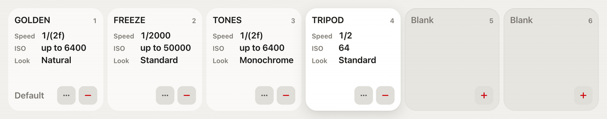
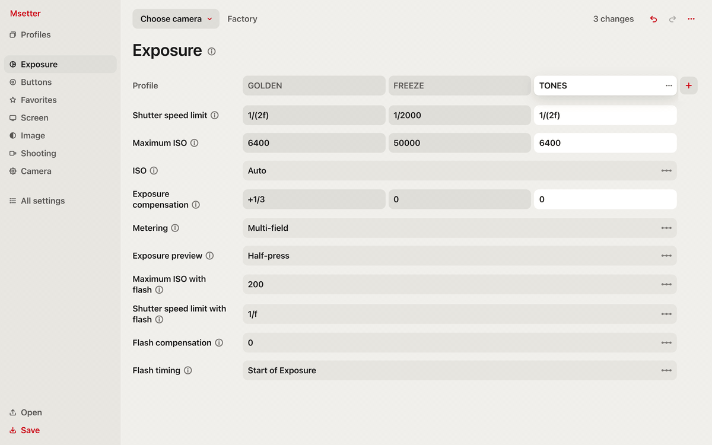

# Msetter

Set up your Leica M on a big screen: what each button does, your Favorites and screen layouts, every menu setting and up to six user profiles. Msetter saves the settings file the camera imports from its card. Everything stays in your browser, and the camera changes only when you import.

Works on the M11, M11-P, M11 Monochrom and M-EV1, and as an experiment on the Q3, Q3 43 and Q2.

**[Open the app](https://timoarnall.github.io/msetter/app/)** · [Get the Mac app](https://github.com/timoarnall/msetter/releases/latest) · [Project page](https://timoarnall.github.io/msetter/)

<picture>
  <source media="(prefers-color-scheme: dark)" srcset="site/images/adding-profiles-dark.gif">
  
</picture>

## User profiles

Make up to six profiles, each with its own exposure, look and shooting settings. Start from the library, from your camera's own file or from blank, and drag the cards into the order the camera lists them in.

<picture>
  <source media="(prefers-color-scheme: dark)" srcset="site/images/reordering-profiles-dark.gif">
  
</picture>

## Every setting side by side

Each profile is a column. A setting every profile shares is one bar: change it once and every profile follows. A change gets a green tick, then a red dot that stays until you save.

<picture>
  <source media="(prefers-color-scheme: dark)" srcset="site/images/values-dark.gif">
  
</picture>

## Favorites and screen layouts

Favorites is your own menu page, in the order you drag it into, and the center button steps through four screen layouts. The camera screen beside each shows it as the camera will.

<picture>
  <source media="(prefers-color-scheme: dark)" srcset="site/images/favorites-dark.gif">
  
</picture>

## Save and check

Save makes one file for each camera you choose, so two cameras stay alike.

<picture>
  <source media="(prefers-color-scheme: dark)" srcset="site/images/save-dark.gif">
  
</picture>

The steps, the Mac app and what macOS says about it are on the [project page](https://timoarnall.github.io/msetter/#save). [If something goes wrong](docs/if-something-goes-wrong.md).

## Documentation

- [How Msetter works](docs/how-msetter-works.md): the settings file, what import does, one file per camera
- [Every setting](docs/settings/README.md), the [file format](docs/file-format.md) and the [cameras compared](docs/cameras.md)
- [Leica Q cameras](docs/leica-q.md), the experiment and how to help
- [Contributing](CONTRIBUTING.md): run the checks, report a problem, correct a setting
- [Changes](CHANGELOG.md) and [releases](https://github.com/timoarnall/msetter/releases)

## About

Msetter is a free app for setting up Leica M11, M11-P, M11 Monochrom and M-EV1 cameras. It saves a settings file that the camera imports from its card. Your profiles stay in this browser, and nothing leaves your computer unless you send a report. Made by Timo Arnall and free under the MIT license; see [LICENSE](LICENSE). Msetter isn’t made by or connected to Leica Camera AG. Leica, M11, M11-P, M11 Monochrom, M-EV1, Q2, Q3, Q3 43, Visoflex and FOTOS are its trademarks. The app contains no Leica firmware, manuals or artwork. The photo on the camera screen is by the author and is not under the MIT license.
