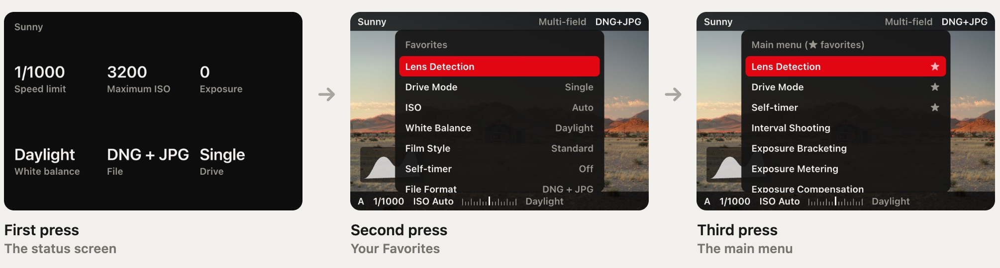
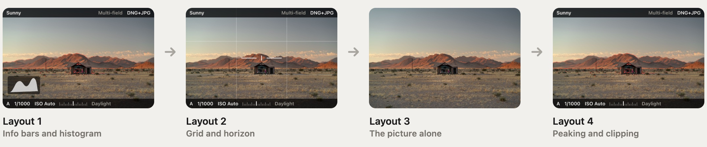
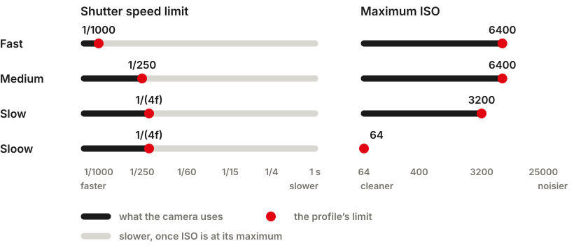

# Msetter

Msetter is a free app for setting up a Leica M from a computer or phone instead of the camera's menus. Choose what each button does, put your Favorites and screen layouts in order, type your copyright and file names on a real keyboard, and design your user profiles side by side. It saves one settings file for each of your cameras, and the camera loads it from its card in one step. **Everything stays in your browser:** files you open and settings you make never leave your computer or phone, and I never see them. Works on the M11, M11-P, M11 Monochrom and M-EV1.

**[Read the project page](https://timoarnall.github.io/msetter/)** or **[try the app](https://timoarnall.github.io/msetter/app/)**.

<a href="https://timoarnall.github.io/msetter/"><picture>
  <source media="(prefers-color-scheme: dark)" srcset="site/images/in-action-dark.gif">
  
</picture></a>

### Why

**Typing on a camera is painful.** Copyright, file names and profile names are spelled out one letter at a time with the arrow pad.

**Menus are deep and small.** Every setting sits a few levels down a menu built for a three-inch screen. A new camera takes hours to set up.

**You keep starting from scratch.** After a reset, a repair or a firmware update, on a new body, and on a camera you borrow or rent, your setup is gone unless you remember it. Lend yours out and it may come back changed.

**The Leica FOTOS app doesn't fix it.** It changes some settings from your phone, one at a time, with little way to organise your buttons, Favorites or user profiles.

**Two cameras drift apart.** An M11-P and an M-EV1 have slightly different menus. Keeping them alike means going through every menu on both.

**Profiles multiply the work.** A change you want everywhere has to be made in every user profile, one at a time.

### What it does

**Buttons.** Choose what the top button, FN, the thumbwheel and the M-EV1's lever do. Click a red button on the drawing and pick its job from a short list, grouped by what it does.

<picture>
  <source media="(prefers-color-scheme: dark)" srcset="site/images/feature-buttons-dark.jpg">
  
</picture>

**Favorites.** The Menu button shows the status screen, then your Favorites, then the main menu. Choose up to eleven items for your Favorites and drag them into order.

<picture>
  <source media="(prefers-color-scheme: dark)" srcset="site/images/feature-menu-strip-dark.jpg">
  
</picture>

**Screen layouts.** The centre button steps through four layouts. Choose what each one shows: info bars, grid, histogram, horizon, clipping or focus peaking.

<picture>
  <source media="(prefers-color-scheme: dark)" srcset="site/images/feature-layouts-strip-dark.jpg">
  
</picture>

**Every menu setting.** Type the artist, copyright and file names on a real keyboard. White balance, film styles, power saving and the rest each have a plain name and one line on what it does.

<picture>
  <source media="(prefers-color-scheme: dark)" srcset="site/images/feature-settings-dark.jpg">
  
</picture>

**User profiles.** Up to six, side by side. A setting that is the same in every profile shows once, so one change reaches them all. With the shutter speed and ISO dials on A, a profile sets limits: how slow the shutter may go before ISO rises, and how high ISO may go. Once ISO reaches its maximum, the shutter goes slower than the limit. Starting sets give you a head start, such as this speed ladder.

<picture>
  <source media="(prefers-color-scheme: dark)" srcset="site/images/limits-dark.svg">
  
</picture>

**One file for each camera.** Design once for every body you own. A value one body doesn't have is swapped for the nearest one it does, and the app lists every swap.

**Nothing leaves your browser.** No server, no account, no tracking. A file you open is read by your browser, not uploaded, and I never see anything you open or make. The Mac app works the same way and writes the file straight to the card.

### How to use it

1. **Pick your cameras.** Msetter makes a separate file for each, so two bodies can share one design even where their menus differ.
2. **Start from your camera or a set.** To start from your camera, export its settings to the card (User Profile › Manage Profiles › Export Profiles) and open the file in the app.
3. **Change what you like.** Settings are grouped by what they are for. Point at a setting to see what it does. Undo takes back anything.
4. **Save and import.** Copy `settings.lcse` to the top of the card, then User Profile › Manage Profiles › Import Profiles. Export your own settings first if you want a way back.

The camera doesn't say when it skips a value, so check a few settings after your first import.

**[Try the app](https://timoarnall.github.io/msetter/app/)**

### How it works

The camera keeps everything in **one JSON file, `settings.lcse`, at the top level of its card**. `Camera` names the body, `Version` is a number the camera writes, and `Settings` holds the values. Each setting has a four-character code, such as `D00C` for the shutter speed limit. A setting that belongs to a profile holds seven values: the one the camera is using now, then one for each of user profiles one to six. A setting for the whole camera holds one value. The M11, M11-P and M-EV1 write 139 codes, the M11-D 140 and the M11 Monochrom 145.

The file holds **the six profile names, which profiles are saved and which one the camera starts in**, the job of each button (top button, FN, thumbwheel press and turn, FN on pictures, and the M-EV1's FN lever both ways), the Favorites menu in order with up to 11 items per profile, the four screen layouts, and everything else in the camera's menus, from white balance and film styles to file names, copyright and power saving.

When you import, **the camera first checks that the `Camera` name in the file matches its own exactly**. If it doesn't, nothing is imported and nothing is shown. If it does, the camera reads each value on its own: **a value it doesn't allow is skipped and the old value kept**, and a code missing from the file keeps its current value. **Profiles not marked as saved are reset.** None of this shows a message, so Msetter lists the values a camera would skip when you open a file, and marks the profiles it saves.

**A file can't move the dials or the lens.** Shutter speed, aperture and the ISO dial stay where they are, so a profile sets limits for A instead. A file also can't set the date, the time or the camera's network name, or reorder the main menu, and **user profiles can only be switched from a button**, not a dial. On the M-EV1, which has no ISO dial, the ISO is in the file; on the M11-P the same code sets the ISO the dial uses at M.

**Msetter makes no network requests.** It is a page of static files: a file you open is read with the browser's file reader, your design is kept in the browser's local storage on your device, and clearing the site's data removes it. A test fails if the app code ever gains a network call.

Msetter knows **every setting's factory value**, so it can build a file from scratch for any of these bodies, without a file from the camera. The M11-D also has a settings file, but no user profiles and no way to import one: neither the camera nor the Leica FOTOS app offers Import Profiles (M11-D manual; owners on the Leica forum, November 2024). **Files from Msetter match the camera's own.** Given the same values, a file built from scratch is the same, byte for byte, as a real export, apart from the network name, which newer firmware leaves out. A test checks this on every change. The camera has also imported a file edited by hand.

The **documentation** lists every code with its allowed values and its factory value on each camera in [docs/settings](docs/settings/README.md). How the controls, menus, Favorites and screen layouts fit together, with page references to Leica's manuals, is in [docs/interaction-architecture.md](docs/interaction-architecture.md). The file format is in [docs/file-format.md](docs/file-format.md), the differences between bodies in [docs/cameras.md](docs/cameras.md), and the questions anyone with a camera can help settle in [docs/open-questions.md](docs/open-questions.md).

| Path | What it is |
|---|---|
| `index.html`, `src/app.js`, `src/app.css` | The app |
| `src/engine.js` | Reads, checks, converts and writes settings files; used by the app and the tests |
| `src/rules.js` | Every code for every camera: kind, allowed values, factory value, the camera's own names. Generated; don't edit by hand |
| `src/catalogue.js` | Plain names, help, notes and the grouping of job lists |
| `src/sets.js` | The starting sets |
| `src/camera.js`, `src/photos.js` | The camera drawing, the camera screen and its photo |
| `site/` | This project's page on GitHub Pages; the app is published beside it at `app/`. `tools/build_limits_chart.js` draws its limits chart from the Speed ladder |
| `mac/` | The Mac app around the same page, with card writing and backups |
| `docs/` | The documentation; `docs/settings/` is generated by `tools/build_docs.py` |

To **add a starting set**, edit `src/sets.js`; the tests check every value on the M11-P and M-EV1 and convert it to the other bodies. Plain names and help live in `src/catalogue.js`; run `python3 tools/build_docs.py` afterwards to refresh the docs. To add a camera or a firmware version, start from a real export with the artist, copyright and network name blanked, and see [docs/README.md](docs/README.md). `node --test test/*.test.js` runs the tests, which also run on every push; `test/browser-check.js` clicks through the app in Safari's engine and Chrome at desktop and phone sizes. Build the Mac app with `zsh mac/build.sh`.

Free, under the MIT licence; see [LICENSE](LICENSE). The photo on the camera screen is by Timo Arnall. Msetter is not made by or connected to Leica Camera AG; Leica, M11 and M-EV1 are its trademarks. The app contains no Leica firmware, manuals or artwork.
