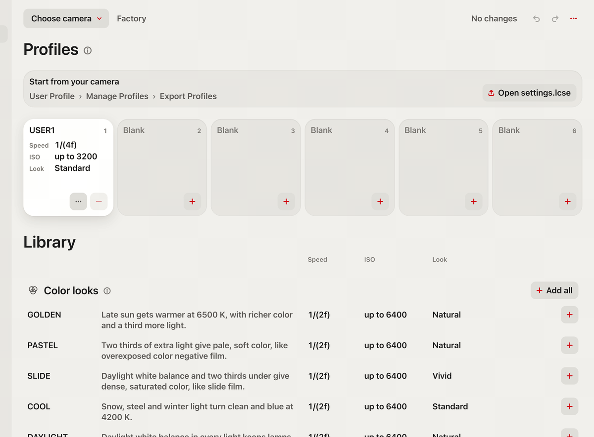
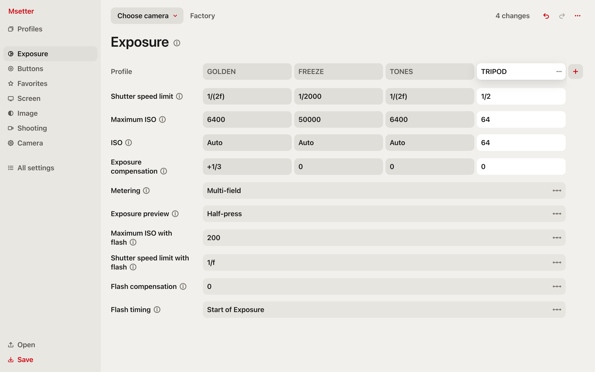
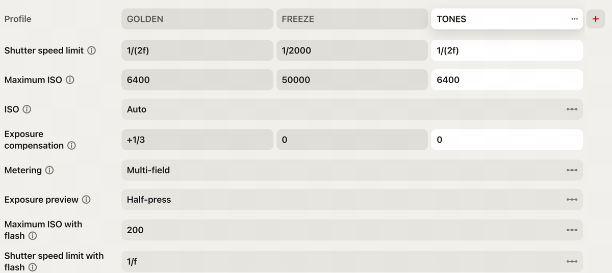
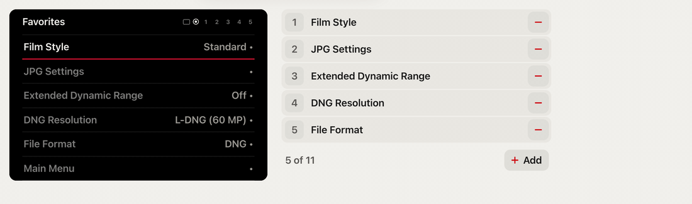

# Msetter

Set up your Leica M on a big screen. See your user profiles side by side, put them in order, and keep settings the same across profiles and across cameras. Msetter saves the settings file the camera imports from its card.

Works on the M11, M11-P, M11 Monochrom and M-EV1, and as an experiment on the Q3, Q3 43 and Q2.

**[Open the app](https://timoarnall.github.io/msetter/app/)** · [Get the Mac app](https://github.com/timoarnall/msetter/releases/latest) · [Project page](https://timoarnall.github.io/msetter/)

<picture>
  <source media="(prefers-color-scheme: dark)" srcset="site/images/adding-profiles-dark.gif">
  
</picture>

## All your settings on one screen

Each user profile is a column, so you can see how your profiles differ and change them in one place. Make up to six profiles, such as fast for street, slow for a tripod and black and white for the evening. Put the profiles in the order you want them on the camera.

<picture>
  <source media="(prefers-color-scheme: dark)" srcset="site/images/still-table-dark.png">
  
</picture>

## Profiles in sync

A setting your profiles share shows once. Change it and it changes in all of them. When one profile needs its own value, set it per profile.

<picture>
  <source media="(prefers-color-scheme: dark)" srcset="site/images/values-dark.gif">
  
</picture>

## Cameras in sync

Choose two or more cameras and Msetter saves a file for each with the same settings, so an M11-P and an M-EV1 stay set up alike.

<picture>
  <source media="(prefers-color-scheme: dark)" srcset="site/images/save-dark.gif">
  
</picture>

## Fiddly settings

Button jobs, Favorites and screen layouts take many presses to set on the camera. Here you set them on one screen and choose which profiles get them. Type your name and copyright on a real keyboard, and the camera writes them into your pictures.

<picture>
  <source media="(prefers-color-scheme: dark)" srcset="site/images/favorites-dark.gif">
  
</picture>

## Starting points from pros

Start from a library of user profiles based on how working photographers set up their Leica M for street, portraits, landscape, night and more. Add one profile or a whole set and change what you like, or start from your camera’s own file. [What pros do](docs/pro-practice.md)

The steps, the Mac app and what macOS says about it are on the [project page](https://timoarnall.github.io/msetter/#save). [If something goes wrong](docs/if-something-goes-wrong.md).

## Documentation

- [How Msetter works](docs/how-msetter-works.md): the settings file, what import does, one file per camera
- [Every setting](docs/settings/README.md), the [file format](docs/file-format.md) and the [cameras compared](docs/cameras.md)
- [Leica Q cameras](docs/leica-q.md), the experiment and how to help
- [Contributing](CONTRIBUTING.md): run the checks, report a problem, correct a setting
- [Changes](CHANGELOG.md) and [releases](https://github.com/timoarnall/msetter/releases)

## About

Msetter is a free app for setting up Leica M11, M11-P, M11 Monochrom and M-EV1 cameras. It saves a settings file that the camera imports from its card. Your profiles stay in this browser, and nothing leaves your computer unless you send a report. Made by Timo Arnall and free under the MIT license; see [LICENSE](LICENSE). Msetter isn’t made by or connected to Leica Camera AG. Leica, M11, M11-P, M11 Monochrom, M-EV1, Q2, Q3, Q3 43, Visoflex and FOTOS are its trademarks. The app contains no Leica firmware, manuals or artwork. The photo on the camera screen is by the author and is not under the MIT license.
